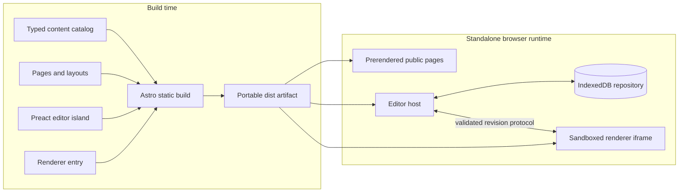

# Architecture

## Goals

Open Mermaid v1 is a browser application that remains fully useful without a backend, account, API key, network analytics service, runtime CDN, AI provider, or ChatGPT connection. The deployable product is a portable static `dist/` directory.

The design optimizes for:

- a clear local-data boundary;
- small, prerendered public pages;
- an ergonomic editor for beginners and experienced Mermaid authors;
- containment of untrusted source and generated SVG;
- provider-neutral contracts that optional future integrations can consume;
- measurable performance, accessibility, security, and compatibility gates.

## Build-time and runtime topology



Public routes contain semantic HTML and static SVG illustrations. They do not import Mermaid, CodeMirror, IndexedDB services, or the editor island. The editor route hydrates one Preact island. Mermaid loads only in the renderer bundle used by the sandboxed iframe.

The canonical self-hosted delivery path adds no application service:

```text
Internet -> host Caddy :80/:443 -> 127.0.0.1:8088 -> static container :8080 -> dist/
```

Caddy is the only public edge. Docker packages the exact tested artifact and publishes the static server only on host loopback. The image contains Nginx configuration and `dist/`, but no Node runtime, source tree, dependency store, account service, application secret, or writable content volume. Other compliant static hosts can still serve the same `dist/` directly.

## Layer boundaries

### Static content layer

Owned by Astro layouts, typed English content, guide/template data, and prerendered pages. It provides canonical metadata, Open Graph fields, breadcrumbs, truthful JSON-LD, sitemap entries, robots policy, `llms.txt`, and accessible no-JavaScript examples.

Rules:

- no Mermaid or CodeMirror import;
- no network analytics service, outbound telemetry, remote fonts, runtime content APIs, or
  client-side rendering requirement;
- no generated claims such as ratings or automatic accessibility conformance;
- every template/guide exposes useful source and prose in HTML.

### Static delivery layer

The optional self-hosted delivery layer is operational packaging, not application architecture. Its boundaries are:

- the release build and all application tests finish before image assembly;
- the image runs an exact digest-pinned unprivileged base as a fixed non-root UID;
- Compose applies a read-only root, dropped capabilities, `no-new-privileges`, bounded processes/logs, and a loopback-only port;
- the static server owns MIME, cache policy, the tested main/renderer response headers, `/healthz`, and a real 404;
- host Caddy owns certificates, canonical redirects, HSTS, compression, and reverse-proxy health checks;
- neither layer receives browser document source, URL fragments, or an application credential.

### Shared core

Provider-neutral TypeScript contracts and pure transformations:

- `DiagramDocumentV1` and versioned migrations;
- `ShareEnvelopeV1` and bounded fragment codec;
- import parsing and filename normalization;
- export options and sanitized-output types;
- `DiagramRepository` interface;
- `EditorHostBridge` capability contract;
- renderer protocol message validation.

This layer cannot import framework UI, ChatGPT, MCP, OpenAI, AI-provider, ad-provider, or deployment packages.

### Local document service

An IndexedDB implementation of `DiagramRepository` stores versioned documents and revisions. UI services add autosave, search/sort, duplicate/rename, delete undo, quota recovery, and multi-tab conflict detection. A document write compares the expected revision to the stored revision; conflicts are surfaced rather than silently overwritten. While a draft is waiting for its debounced IndexedDB write, one validated active-draft recovery record is mirrored synchronously in same-origin browser storage. This journal closes the browser-unload data-loss window and is removed as soon as matching content is durable in IndexedDB.

### Editor island

Preact owns application state and coordinates CodeMirror, the local document service, import/export, template selection, URL snapshots, the renderer client, responsive source/preview modes, and host capabilities. It does not parse or render Mermaid in the parent document.

### Sandboxed renderer

The preview iframe is application-owned and uses `sandbox="allow-scripts"` without same-origin privileges. It validates every message, serializes Mermaid work, pins strict secure configuration, suppresses Mermaid’s built-in error insertion, sanitizes SVG, and returns only revision-associated results.

The parent validates `event.source`, message shape, protocol version, request ID, and revision; discards stale results; keeps the last valid iframe preview; and replaces the renderer after a bounded timeout. The parent never inserts the returned SVG into its own DOM. Sanitized SVG crosses the boundary only for explicit copy/export paths.

## Core interfaces

```ts
interface DiagramDocumentV1 {
  schemaVersion: 1;
  id: string;
  title: string;
  source: string;
  createdWithMermaid: string;
  appearance: {
    theme: 'default' | 'neutral' | 'dark' | 'forest';
    background: 'transparent' | 'light' | 'dark';
  };
  revision: number;
  createdAt: string;
  updatedAt: string;
}

interface ShareEnvelopeV1 {
  version: 1;
  title?: string;
  source: string;
  createdWithMermaid: string;
  appearance: DiagramDocumentV1['appearance'];
}

interface DiagramRepository {
  list(): Promise<DiagramDocumentV1[]>;
  get(id: string): Promise<DiagramDocumentV1 | undefined>;
  put(document: DiagramDocumentV1): Promise<void>;
  delete(id: string): Promise<void>;
}

interface EditorHostBridge {
  capabilities: {
    publishDocument: boolean;
    fullscreen: boolean;
    externalNavigation: boolean;
    fileUpload: boolean;
  };
  publishDocument?(document: DiagramDocumentV1): Promise<void>;
}
```

Contracts are versioned at persistence, share, and message boundaries. Unknown future versions fail closed with a user-readable recovery path; they are never guessed into an older schema.

## Data flows

### Normal edit

1. CodeMirror emits a source change.
2. Editor state increments a local revision and schedules autosave and debounced rendering.
3. The repository checks the stored revision before persisting.
4. The renderer client posts a bounded, validated request to the iframe.
5. The iframe parses, renders, sanitizes, and displays the preview internally.
6. A matching success updates status; a matching diagnostic preserves the last valid preview.

### Snapshot share

1. User explicitly chooses **Share snapshot**.
2. The editor creates a minimal `ShareEnvelopeV1`; local IDs and timestamps are excluded.
3. JSON is UTF-8 encoded, zlib-compressed, and base64url encoded as `#v1:<payload>`.
4. Compressed and final URL limits are checked before copying.
5. A fresh browser validates the prefix and characters, checks compressed size, uses bounded decompression, validates the exact schema and source limit, and creates a new local document only after user intent.

Fragments are not encrypted. They avoid inclusion in ordinary HTTP requests but remain exposed to recipients, history, clipboards, extensions, screenshots, and destinations where pasted.

### Export

1. User explicitly selects source, SVG, or PNG and options.
2. Source export applies safe filename rules and writes the preserved text.
3. SVG export requests the latest sanitized SVG associated with the active revision.
4. PNG export draws sanitized SVG into a local canvas with bounded dimensions, selected scale, and selected background.
5. Object URLs are short-lived and revoked after the download starts.

## Performance model

- Static pages hydrate nothing unless a small page-specific behavior such as template filtering is required.
- Mermaid and CodeMirror must not appear in public route chunks.
- System fonts eliminate font downloads and text reflow.
- The editor island is isolated to `/editor/`; Mermaid stays in the renderer chunk.
- Rendering is debounced and serialized instead of starting unbounded concurrent work.
- Bundle budgets and Lighthouse gates are checked against built output.

Targets are Lighthouse 100 on static content routes with a hard floor of 98, Performance at least
95 for the editor and interactive diagnostics route, and 100 Accessibility/Best Practices/SEO.
Field objectives are p75 LCP at most 2.5 seconds, INP at most 200 ms, and CLS at most 0.1.

Lighthouse's `robots-txt` audit is excluded from the category score because some Chrome/Lighthouse protocol combinations cannot retrieve the file even when it is served successfully. The built-site gate independently requires and validates the portable `robots.txt`; crawlability is also skipped for intentionally noindexed preview builds.

## Future dependency direction

```text
future ChatGPT widget -----> shared contracts <----- standalone editor
future MCP service --------> shared contracts
future funded AI adapter --> validated document-creation path

shared contracts -X-> ChatGPT / MCP / OpenAI / AI provider
standalone app   -X-> future integration configuration
```

A future ChatGPT widget is not a mode hidden inside the standalone bundle. It is a separate build and deployment with its own disclosures, CSP, host bridge, MCP endpoint, funding, review, and failure behavior. The standalone editor continues to work when that entire system is unavailable.

## Deferred v1 concerns

Accounts, backend persistence, cloud sync, collaboration, public gallery, network analytics,
session replay, AI, ChatGPT code, active ads, PWA/service worker, offline guarantees, visual
drag-and-drop editing, PDF, and JPEG are outside the v1 runtime and dependency graph.
